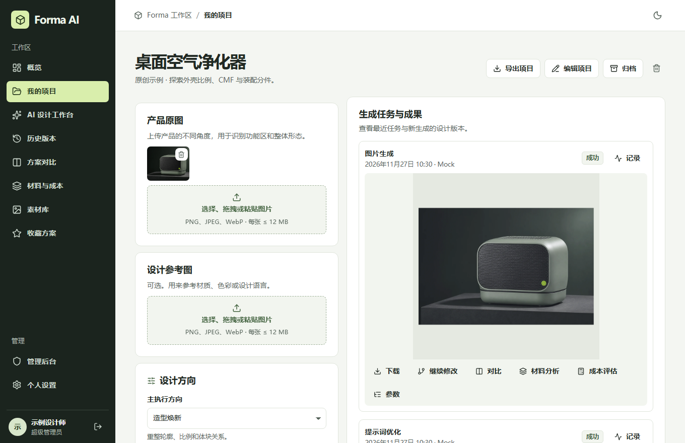
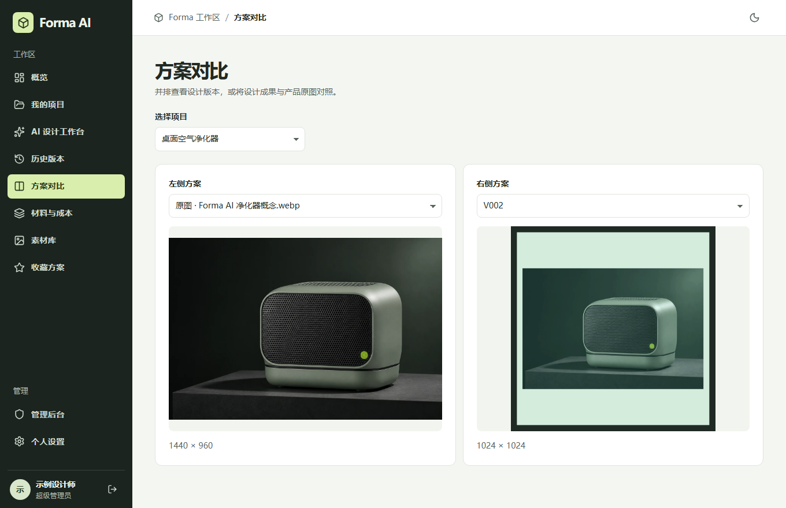
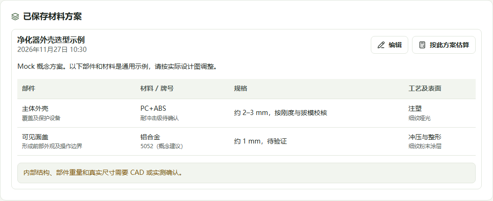
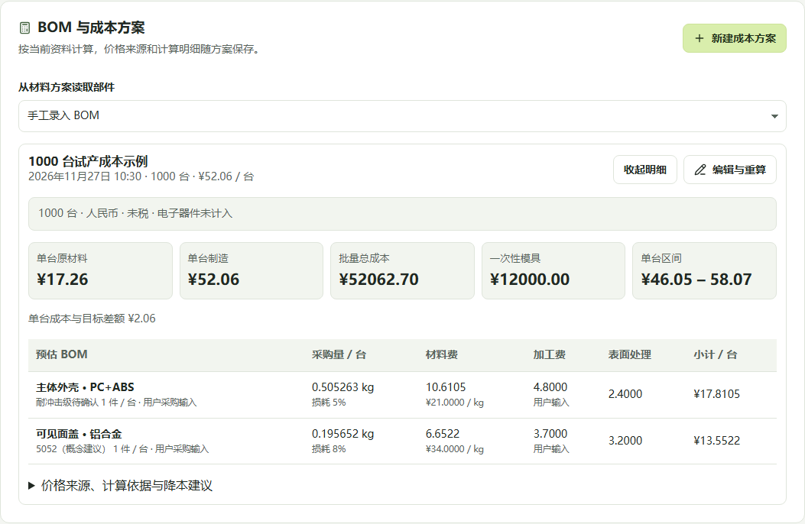

# Forma AI

[简体中文](README.md) · [Feature walkthrough](#feature-walkthrough) · [Quick start](#quick-start) · [Deployment guide](docs/DEPLOYMENT.en.md)

Forma AI is a Chinese-language workspace for industrial design and hardware development. Keep product photos, reference images, generation jobs, and design versions in one project. Use a selected version to plan materials, build a bill of materials (BOM), and estimate manufacturing costs.



The screenshots follow the built-in desktop air purifier demo. The generated results, material suggestions, and costs shown are sample data.

## Feature walkthrough

### Generate designs and refine prompts

1. Create a project in **我的项目** (My Projects) and upload product photos and optional references. Use multiple angles to show the product, and references to indicate colors, materials, or styling.
2. Choose primary and secondary design directions and an L1–L5 redesign level. Describe the goal and what must be preserved. Use **AI 优化** (Refine with AI) to organize the request, then edit the resulting draft or preview the prompt.
3. Choose the size, angle, background, and quantity supported by the model. Submit the job to see its status and download the results. Each job keeps its generation settings and provides a retry entry when applicable.

### Branch and compare versions

Every generated image gets its own version number and retains the output, input assets, prompt, and generation settings. Select **继续修改** (Continue Editing) to branch from any version. After generating `V002` from `V001`, for example, use **方案对比** (Compare Designs) to compare `V002` with the original photo or select two design versions side by side.



### Select materials and review manufacturing processes

Open **材料分析** (Material Analysis) from a design result to run material or manufacturing process analysis for that version. Adopt a suggestion and edit components, grades, thicknesses, processes, and finishes. Save multiple plans for a version and use CAD or measurements to fill in dimensions, weights, and internal details.



### Estimate manufacturing costs with a BOM

Start a BOM from a material plan or enter the parts yourself. Fill in quantities, weights or dimensions, scrap rates, supplier prices, and processing and finishing costs. Enter prices directly or pick quotes from the material price library, which supports Excel import and export. Set the batch size, tooling and assembly costs, tax treatment, and electronics scope. The saved plan includes per-unit costs, batch totals, an estimate range, part-level calculations, price sources, and missing inputs.



### Manage projects, accounts, and models

- **Project handoff** Search, favorite, archive, or restore projects. Export assets, versions, generation settings, and analysis plans in a project ZIP.
- **Accounts and operations** Admins manage member accounts, prompt templates, and the price library. Super admins can review provider calls and create full-instance backups for recovery.
- **Model configuration** Explore the workflow with the built-in Mock provider. Super admins can configure OpenAI, OpenAI Compatible, and Gemini API, test model capabilities, and assign different default models to different tasks.

## Quick start

Clone the repository or extract the source ZIP. Run the relevant command from the directory that contains `compose.yaml`.

**Windows without Docker** requires Python 3.12, Node.js 22.12 or later in the 22.x series, and npm. This mode uses SQLite.

```powershell
powershell -NoProfile -ExecutionPolicy Bypass -File .\scripts\start-local.ps1
```

Open `http://localhost:8080/` and use the token in `.runtime\local\setup.token` to create the super admin. The script listens on loopback by default.

**Docker Compose on Windows** requires Docker Desktop in Linux container mode. This mode uses PostgreSQL 17.

```powershell
powershell -NoProfile -ExecutionPolicy Bypass -File .\scripts\start.ps1
```

Open `http://localhost:8080/`. The first-run token is `APP_SETUP_TOKEN` in your local `.env`. See the [deployment guide](docs/DEPLOYMENT.en.md) for Linux, networking, HTTPS, and recovery.

After signing in, select **试用示例** (Try the Demo) to follow the walkthrough. Mock runs locally without an API key or GPU.

## Credentials and data

Generate instance passwords and setup tokens during deployment. Enter provider API keys in your running instance. Keep real `.env` files, `.runtime/`, databases, key files, backups, and project images in the deployment environment. The application sends selected project inputs to an external provider only after an operator confirms the request.

## Developer documentation

The `frontend/` uses React, TypeScript, and Vite. The `backend/` uses FastAPI, SQLAlchemy, and Alembic. In production, FastAPI serves the web app and the same-origin `/api` routes.

- [Product requirements](docs/PRD.md) · [UI specification](docs/UI.md) · [Prompt design](docs/PROMPTS.md)
- [Architecture](docs/ARCHITECTURE.md) · [Database](docs/DATABASE.md) · [API](docs/API.md)
- [Testing](docs/TEST.md) · [Development progress](docs/PROGRESS.md)

The developer documentation linked above is in Chinese.
