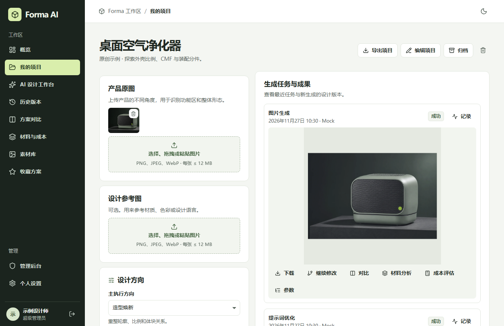
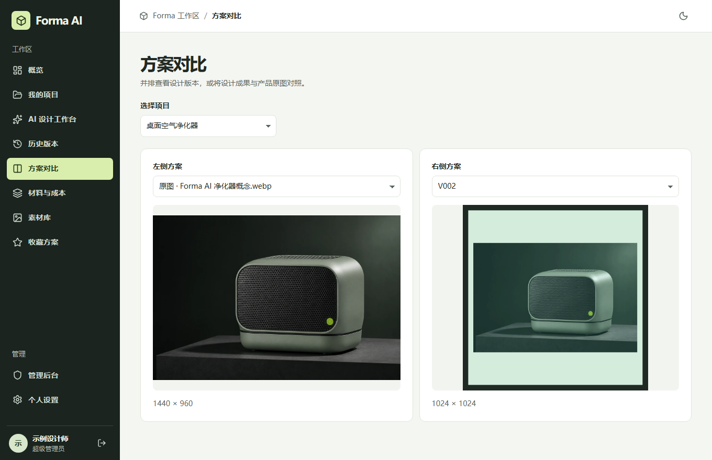
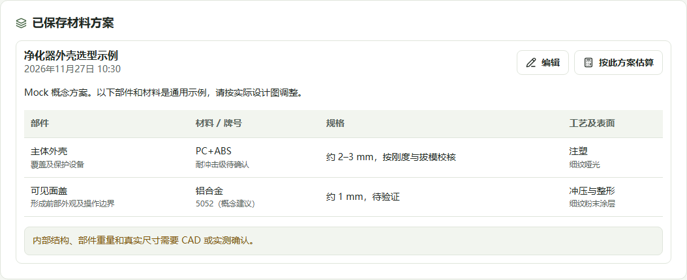
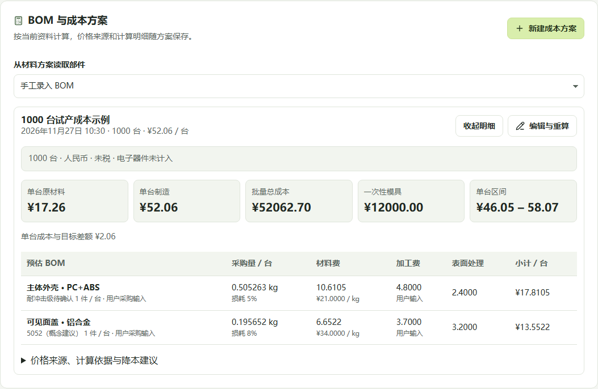

# Forma AI

[English](README.en.md) · [功能导览](#功能导览) · [快速开始](#快速开始) · [部署指南](docs/DEPLOYMENT.md)

Forma AI 是面向工业设计和硬件研发的中文工作台。一个项目内可以汇总产品原图、参考图、生成任务和设计版本，再以选定版本为基础制定材料方案、整理 BOM（物料清单）和估算制造成本。



配图使用内置「桌面空气净化器」示例。界面中的生成结果、材料建议和成本数字均为演示数据。

## 功能导览

### 设计生成与提示词优化

1. 在「我的项目」创建项目，上传产品原图和可选参考图。原图可以覆盖多个角度，参考图用于表达配色、材质和外观方向。
2. 选择主辅方向和 L1–L5 重构档位，填写「原始需求」和「必须保留」。用「AI 优化」整理需求，也可以直接编辑最终需求和预览将提交的提示词。
3. 按模型支持的能力选择尺寸、视角、背景和数量，提交「生成设计」。任务卡显示进度与结果，可查看生成参数、下载成果，或按原任务配置重试失败项。

### 版本迭代与方案对比

每张生成结果都有独立的版本编号，保留输出、输入素材、提示词和参数。点「继续修改」可从任意成果创建分支。例如，以 `V001` 为父版本生成 `V002` 后，可以通过「方案对比」并排检查 `V002` 和产品原图，也可以选取两个设计版本互相对照。



### 材料选型与制造分析

从成果卡片进入「材料分析」，选定版本后可运行材料分析或制造工艺分析。采用材料建议后，可以编辑部件、材料牌号、厚度、工艺和表面处理，为同一版本保存多份方案。内部结构、尺寸和重量可结合 CAD 或实测补齐。



### 成本评估与 BOM

从材料方案带入部件，或手工建立 BOM。为部件补充用量、重量或尺寸、损耗、采购单价、加工及表面处理费用。采购价格可以手工填写，也可以从支持 Excel 导入与导出的材料价格库选择。设置生产批量、模具、装配、税费和电子件范围后，可保存单台制造成本、批量总成本、估算区间及逐项明细。方案会记录价格来源和待确认项。



### 项目管理与模型接入

- **项目交付** 搜索、收藏、归档或恢复项目，可导出包含素材、版本、生成参数和分析方案的项目 ZIP。
- **账号与运维** 管理员配置成员账号、提示词模板和价格库。超管可查看调用记录并创建整站备份，供实例恢复使用。
- **模型配置** 内置 Mock 可直接体验流程。超管可以接入 OpenAI、OpenAI Compatible 或 Gemini API，测试模型能力，并为不同任务指定默认模型。

## 快速开始

克隆本仓库或解压源码 ZIP，在含 `compose.yaml` 的目录执行对应命令。

**Windows 原生**需要 Python 3.12、Node.js 22.12 以上的 22.x 和 npm，使用 SQLite。

```powershell
powershell -NoProfile -ExecutionPolicy Bypass -File .\scripts\start-local.ps1
```

打开 `http://localhost:8080/`，用 `.runtime\local\setup.token` 中的令牌创建超级管理员。脚本默认仅监听本机。

**Windows Docker Compose** 需要启动 Docker Desktop 并选择 Linux 容器，使用 PostgreSQL 17。

```powershell
powershell -NoProfile -ExecutionPolicy Bypass -File .\scripts\start.ps1
```

打开 `http://localhost:8080/`，首次初始化令牌为本地 `.env` 中的 `APP_SETUP_TOKEN`。Linux 启动、端口、HTTPS 和恢复步骤见 [部署指南](docs/DEPLOYMENT.md)。

登录后点击「试用示例」，即可复现上面的工作流。Mock 在本地运行，无需 API Key 或 GPU。

## 凭据与数据

部署时生成实例口令和初始化令牌。仅在自己的实例中录入服务商 API Key。将实际 `.env`、`.runtime/`、数据库、密钥文件、备份和业务图片保存在部署环境中。业务图片和需求仅在操作者确认后随任务发送给所选外部服务。

## 开发文档

React、TypeScript 和 Vite 位于 `frontend/`。FastAPI、SQLAlchemy 和 Alembic 位于 `backend/`。生产环境由 FastAPI 提供页面，前后端通过同源的 `/api` 通信。

- [产品需求](docs/PRD.md) · [交互规范](docs/UI.md) · [提示词](docs/PROMPTS.md)
- [技术架构](docs/ARCHITECTURE.md) · [数据库](docs/DATABASE.md) · [业务 API](docs/API.md)
- [测试与验收](docs/TEST.md) · [开发进度](docs/PROGRESS.md)
